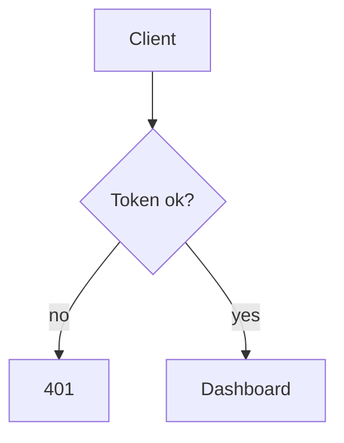

# glowmaid

[glow](https://github.com/charmbracelet/glow) with Mermaid diagrams.

Mermaid fences in a markdown file are rewritten into Unicode terminal art before
the document reaches glow, so you read diagrams instead of source. Everything
glow does is left alone: flags pass straight through, and a document with no
mermaid goes to glow untouched.

## Demo

This fence is real. Run `glowmaid README.md` to see it drawn:



Rendered, that becomes:

```
┌───────────┐
│  Client   │
└─────┬─────┘
      ▼
┌─────◇─────┐
│ Token ok? │
└─────◇─────┘
      │
      │
      ├────────────────╮yes
    no│                │
      ▼                ▼
┌───────────┐    ┌───────────┐
│    401    │    │ Dashboard │
└───────────┘    └───────────┘
```

## Requirements

| Tool      | Role                                                                   |
| --------- | ---------------------------------------------------------------------- |
| `glow`    | renders the markdown (required)                                        |
| `termaid` | flowcharts, state, class, ER, mindmap, pie, gantt, kanban, timeline, … |
| `merman`  | sequence diagrams, and flowcharts with converging edges                |

At least one backend is needed; whichever is missing is skipped. A diagram no
backend can draw is shown as source with a one-line note explaining why.

Works on macOS and Linux. On Linux, `script` comes from util-linux, which most
distros install by default. Linuxbrew's `/home/linuxbrew/.linuxbrew/bin` is
searched along with `$PATH`.

```bash
brew install glow                   # or: go install github.com/charmbracelet/glow@latest
uv tool install "termaid[rich]"     # or: pipx install "termaid[rich]"
bun add -g @kitlangton/merman       # or: npm i -g @kitlangton/merman
```

The `[rich]` extra is what gives termaid its color themes. Without it diagrams
still render, just uncolored.

## Install

```bash
git clone <this> ~/Documents/me/glowmaid
ln -sf ~/Documents/me/glowmaid/glowmaid /usr/local/bin/glowmaid
```

A `glowm` symlink alongside it also works — the command used to be called
`glowm`, and the `GLOWM_*` env vars still resolve.

## Usage

```bash
glowmaid README.md                  # or: glowmaid -p README.md
cat README.md | glowmaid
glowmaid -w 0 -s dark docs/design.md
glowmaid --clear-cache
```

Arguments are glow's arguments. Anything glowmaid cannot preprocess — `--help`,
`--version`, `--tui`, a directory, more than one source — is handed to glow
as-is.

## Configuration

| Variable             | Default             | Meaning                              |
| -------------------- | ------------------- | ------------------------------------ |
| `GLOWMAID_THEME`     | `terra`             | termaid color theme                  |
| `GLOWMAID_WIDTH`     | terminal width      | max diagram width                    |
| `GLOWMAID_BACKEND`   | `auto`              | force `termaid`, `merman`, or `auto` |
| `GLOWMAID_SHAPES`    | _degrade_           | `native` to render shapes as written |
| `GLOWMAID_NO_CACHE`  | —                   | `1` bypasses the render cache        |
| `GLOWMAID_CACHE_DIR` | `~/.cache/glowmaid` | cache location                       |
| `GLOWMAID_DEBUG`     | —                   | `1` logs backend attempts to stderr  |
| `NO_COLOR`           | —                   | any value disables diagram color     |

Themes with a background fill (`dracula`, `nord`, `gruvbox`, `monokai`,
`solarized`) paint dark blocks that fight glow's own code-block styling, which
is why the default is `terra` — mid-tone, no background, readable on light and
dark terminals alike. `termaid --themes` lists them all.

## How it works

**Backend routing.** No single renderer is good at everything, so glowmaid picks
per diagram:

- `sequenceDiagram` → merman. Cleaner arrows and colored request/response labels.
- flowchart with a **converging edge** → merman. termaid's router cannot join
  two edges into one node and lands arrows under the wrong nodes:
  `▼ ▼────────╯`. merman routes it correctly, at the cost of being taller.
- everything else → termaid. Roughly 40% more compact than merman, and better
  shape handling.

If the first choice fails or returns nothing, the other is tried, then the
source is shown with a note.

**Shape degrading.** Every ASCII renderer tested tears on the same node shapes —
a `[(Database)]` cylinder comes out as a doubled bottom border, and stadiums,
hexagons and parallelograms break too. Those shapes are rewritten to the nearest
one that renders cleanly (`E[(Database)]` becomes `E(Database)`) before drawing.
This only affects the rendered view; the markdown file is never modified. Set
`GLOWMAID_SHAPES=native` to see the raw shapes.

**Color from merman.** merman only colorizes when stdout is a tty, so it runs
under `script(1)` with pty artifacts scrubbed. macOS uses the BSD syntax and
Linux the util-linux one (`script -q -e -c "…" /dev/null`). The scrub is
validated against plain output before use and falls back to `--no-color` if it
looks wrong, or if `script` is missing. Other platforms skip straight to plain
output.

**Cache.** Rendered diagrams are cached under `~/.cache/glowmaid`, keyed on the
diagram source, backend binary, options, and glowmaid's own revision, so
upgrading a backend or editing glowmaid invalidates it automatically. Three
diagrams render in about 0.2s; a cached rerun is about 0.05s.

## Development

```bash
node test/unit.test.js      # 71 assertions: fence parsing, shapes, routing
bash test/cli.test.sh       # end-to-end through glow
```

Both run against the working copy, not `$PATH`. The script exports
`normalizeShapes`, `findFences`, `diagramType`, `hasFanIn`, `backendOrder`,
`scrubPty` and `ptyCommand` for testing.
